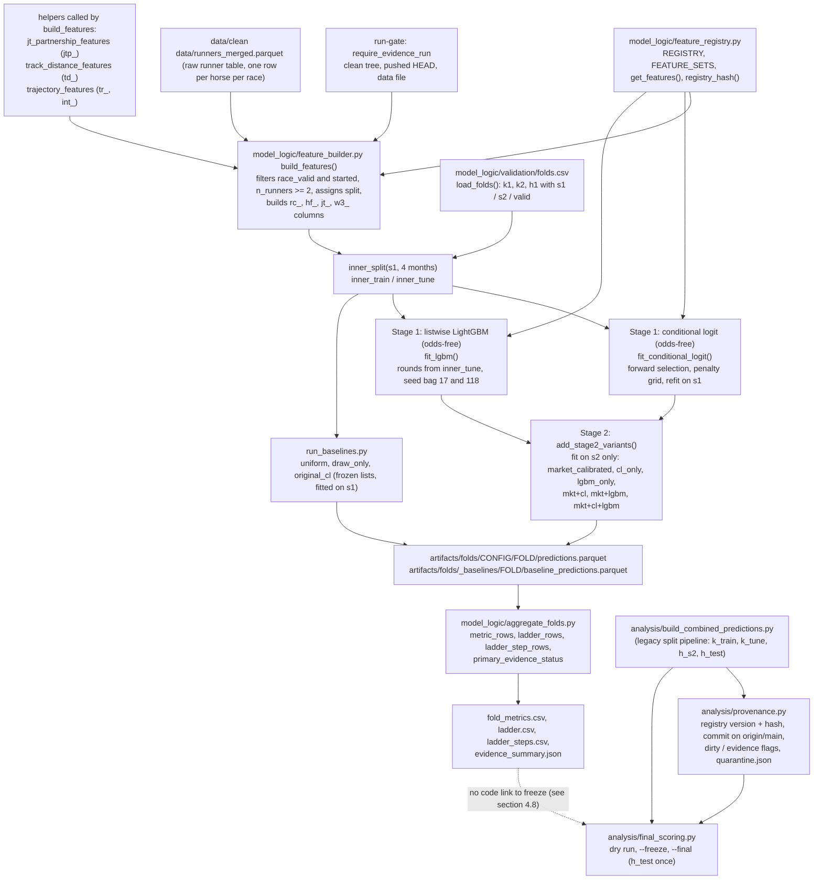
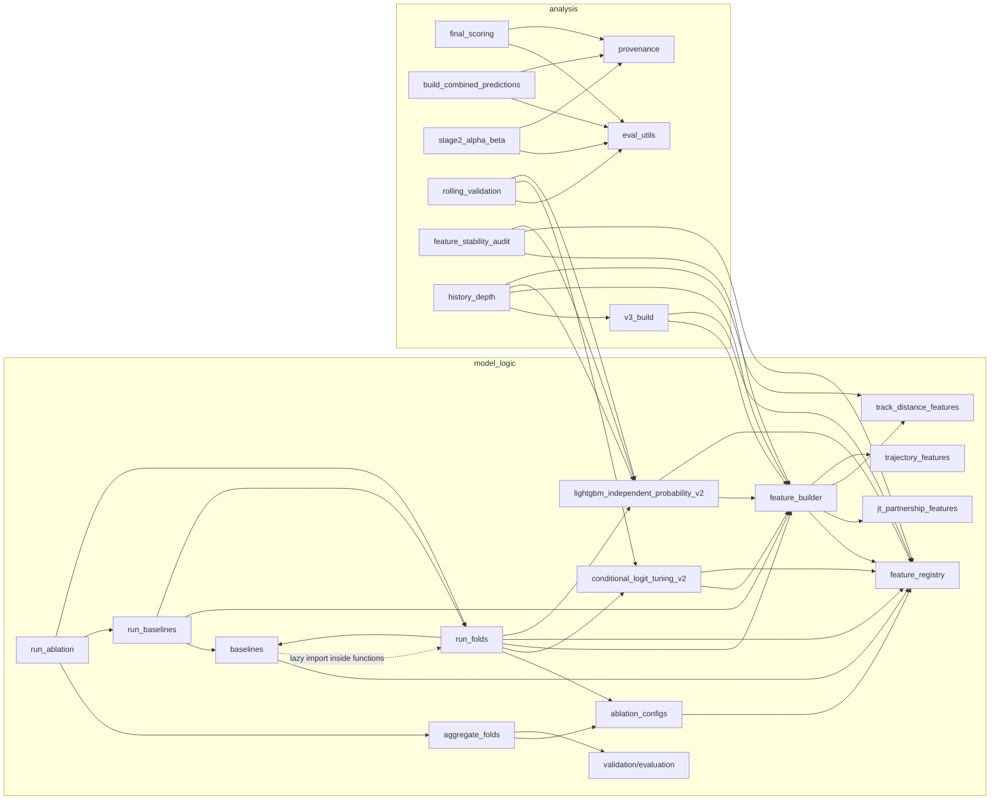

# HKJC-Racing: codebase knowledge

Read-only analysis of the repository at `github/HKJC-Racing`. First written against `main` at `506a056` (2026-11-08); **updated 2026-11-11 to `main` at `0594916`**, which adds Inns's Tier 1-3 work merged by Fahim (PRs #8 and #9: run-gate, quarantine, resume keys, freeze timestamp, v3.1 stability sheet) and a clean-rerun note (PR #10). Statements below describe `0594916` unless they say otherwise. No pipeline, training or scoring script was run, and `data/`, `artifacts/`, `.venv/` and `__pycache__/` were not edited.

Executed, with the project venv (Python 3.14.7, pytest 9.2.0, LightGBM 4.7.0), `PYTHONDONTWRITEBYTECODE=1` and `-p no:cacheprovider` so nothing was written: on `0594916`, `pytest tests` (**85 passed**, 54 s) and `pytest "leakage test/test_leakage.py"` (26 passed, 21 s); on `506a056` the same suites gave 64 and 26. The tests read `data/clean data/runners_merged.parquet` and two `artifacts/` JSON files. Also run: a registry query (`get_features` counts), an import-only check of `market_offset_feature_families`, read-only pandas checks of the processed parquet (pre-test HKJC profile-missing and favourite rates) and of the quarantined `fold_metrics.csv` files.

Conventions used below:

- Every claim cites a path relative to the repo root plus a function, class or constant name.
- "unverified" means the claim comes from documentation, a file listing or a static read only. It was not confirmed by running code or opening a generated file.
- Paths with spaces (`data/clean data/`, `leakage test/`) are real.

## Table of contents

1. [Phase 1: Overview](#phase-1-overview)
2. [Phase 2: Architecture](#phase-2-architecture)
3. [Phase 3: Component analysis](#phase-3-component-analysis)
4. [Phase 4: Rules and gotchas](#phase-4-rules-and-gotchas)
5. [Phase 5: Reference](#phase-5-reference)
6. [Assumptions and unverified items](#assumptions-and-unverified-items)
7. [Things to know before changing code](#things-to-know-before-changing-code)
8. [Files read, files skipped, open questions](#files-read-files-skipped-open-questions)

---

## Phase 1: Overview

### Purpose

The repository builds race-level win-probability models for Hong Kong horse racing and tests one question: on chronologically later races, does a blend of market probabilities and model probabilities have lower per-race log loss than a calibrated market baseline? (`README.md` "Project overview"; `docs/evaluation_protocol.md` "Primary comparison").

It is a research codebase. There are no routes, controllers or databases. All state lives in parquet/CSV/JSON files.

### Models

| Model | What it is | Where |
|---|---|---|
| Conditional logit (CL) | Each race is a choice set. Linear utility per runner, softmax within the race. Dead heats get fractional targets (1/k per tied runner). Optional L1 + within-race-variance ridge penalty. | `model_logic/conditional_logit_tuning_v2.py` (`RaceSet`, `seg_lse`, `make_stages`, `nll_grad`, `fit_beta`, `select_features`); fold wrapper `model_logic/run_folds.py::fit_conditional_logit` |
| Listwise LightGBM | LightGBM trained with a custom race-softmax objective (gradient `p - y`, hessian `max(2p(1-p), 1e-6)`), early stopping on per-race log loss, seed bag. | `model_logic/lightgbm_independent_probability_v2.py` (`Races`, `softmax_objective`, `train_booster`, `bag_utility`, `PARAMS`); fold wrapper `model_logic/run_folds.py::fit_lgbm` |
| Stage-2 blend | `softmax(sum_k theta_k * log p_k)` within the race, fitted by L-BFGS-B with a ridge penalty centred on `theta = (1, 0, 0)`. | `model_logic/lightgbm_independent_probability_v2.py::fit_blend`, `blend_probability` |
| Calibrated market | Stage-2 blend with only `p_market` and `lam = 0`, so `p ∝ p_market^beta`. | `model_logic/run_folds.py::add_stage2_variants` (variant `market_calibrated`) |
| Frozen baselines | `uniform`, `draw_only` (3 draw features), `original_cl` (15 historical features). Fitted on `s1`, no market inputs. | `model_logic/baselines.py`, `model_logic/run_baselines.py` |

### Stages

- Stage 1 is odds-free. CL and LightGBM never see market columns in the fold runner. `stage1_races` sets `mkt_logit` to zeros and `mkt_ok` to False (`model_logic/run_folds.py::stage1_races`), and `run_fold` raises if a CL feature is in `FORBIDDEN_INPUTS` or starts with `mkt_`.
- Stage 2 combines Stage-1 probabilities with the normalised market probability `mkt_p`. It is fitted on the fold's `s2` window only and applied to the later `valid` window (`add_stage2_variants`).
- Evaluation scores the `valid` window per race and compares to the calibrated market and to the baseline ladder (`model_logic/aggregate_folds.py`).
- Freeze and one-shot final scoring are a separate workflow (`analysis/final_scoring.py`).

### How the evaluation question is posed

| Item | Definition | Source |
|---|---|---|
| Primary comparison | `primary` config, variant `mkt+cl+lgbm`, versus `market_calibrated` | `model_logic/aggregate_folds.py::PRIMARY_CONFIG`, `PRIMARY_VARIANT`; `docs/evaluation_protocol.md` |
| Metric | Per-race log loss. For a dead heat: `-log(mean of winners' probabilities)`, clipped at 1e-12 | `model_logic/validation/evaluation.py::race_losses` |
| Gain | calibrated-market loss minus model loss. Positive is better | `aggregate_folds.py::metric_rows` (`gain_vs_calibrated`) |
| Interval | Two-sided 95% paired bootstrap, resampling whole race days, `n_boot=2000`, `seed=0` | `validation/evaluation.py::paired_bootstrap_gain` |
| "Repeatedly" | Every eligible fold has gain > 0 and `ci_vs_calibrated_low > 0`. Eligible = at least 150 inner-tune races | `aggregate_folds.py::primary_evidence_status`, `MIN_INNER_TUNE_RACES`; `docs/evaluation_protocol.md` |
| Everything else | Exploratory | `docs/evaluation_protocol.md` "Baseline ladder" |

The code only computes `eligible_for_freeze` and writes it to `evidence_summary.json`. Nothing in `analysis/final_scoring.py` reads that file (grep for `evidence_summary` finds only `aggregate_folds.py` and `tests/test_run_ablation.py`). See [section 4.8](#48-freeze-and-final-scoring).

### Current status of results

The 6 Nov fold runs (registry `v3.0`, commit `fc759fe`, never pushed) were moved on 8 Nov to `artifacts/quarantine/folds_v3.0_fc759fe/` and listed in `analysis/quarantine.json`, with eight other non-evidence folders (rolling validation, market-offset runs, Stage-2 table, 3-5 Nov LightGBM and partnership runs). `artifacts/folds/` holds only empty folders on 11 Nov (checked: 0 files), so no v3.1 evidence run exists yet. The quarantined `primary/fold_metrics.csv` gives pooled `mkt+cl+lgbm` gain vs calibrated market +0.001510 (95% CI -0.000715 to +0.003848) on 927 races (read 11 Nov). The current combined predictions file is built from a quarantined source, so it cannot be frozen until rebuilt (`analysis/README_EVALUATION.md` "Quarantine").

### Two evaluation lineages

The repo contains two parallel evaluation paths that share the feature builder but nothing else:

| | Fold pipeline (current) | Legacy split pipeline |
|---|---|---|
| Windows | `model_logic/validation/folds.csv` (`s1`/`s2`/`valid` per fold) | `feature_builder.assign_split`: `k_train`, `k_tune`, `h_s2`, `h_test` |
| Entry points | `run_baselines`, `run_folds`, `run_ablation`, `aggregate_folds` | `conditional_logit_tuning_v2.py`, `lightgbm_independent_probability_v2.py`, `analysis/build_combined_predictions.py` |
| Market baseline | `market_calibrated` (beta fitted on `s2`) | `p_market_refit` (beta fitted on `h_s2`, `analysis/eval_utils.py::fit_market_refit_beta`) |
| Consumed by | `aggregate_folds.py`, `stage2_alpha_beta.py` (fold `s2` rows) | `analysis/final_scoring.py` (freeze and h_test) |

`README.md` draws one pipeline ending in "freeze record and one-shot final scoring". In code, `final_scoring.py` only accepts the combined file built from the legacy pipeline (`PREDICTIONS` constant, `build_combined_predictions.py` default `--predictions`).

> **STATE BLOCK, phase 1**
> - Done: purpose, models, stages, evaluation question, two lineages.
> - Key facts: primary test is `mkt+cl+lgbm` vs `market_calibrated`, race-day bootstrap, all-eligible-folds rule.
> - Open: no clean v3.1 run exists yet (checked 11 Nov); how legacy and fold pipelines are meant to meet at freeze.
> - Next: architecture diagram and dependency map.

---

## Phase 2: Architecture

### 2.1 Pipeline diagram

Source: `codebase-analysis-docs/assets/pipeline.mmd`.



Notes on the diagram:

- `inner_split` is applied to `s1` (`run_folds.py::inner_split`): the last `--inner-tune-months` months (default 4) of `s1` become `inner_tune`, the rest `inner_train`. The diagram collapses `s2` and `valid` selection into the Stage-2 node; both are selected by `select_period` + `market_complete` in `run_fold`.
- The dotted edge is the gap described in section 4.8. It is a finding, not an implemented link.

### 2.2 Module dependency map

Source: `codebase-analysis-docs/assets/module_dependencies.mmd`. Edges come from `import` statements I read and show the main project-internal links only. Omitted for readability: `feature_stability_audit` also imports `lightgbm_independent_probability.FEATURES`; `v3_build` imports the three helper modules directly; the market-offset scripts import `feature_builder`, `feature_registry` and each other.



Structural points:

- `feature_registry.py` imports only the standard library, so it is the base of the graph.
- `baselines.py` and `run_folds.py` import each other. `baselines.py` imports `fit_conditional_logit` lazily inside `fit_predict_draw_only` and `fit_predict_original_cl`; `run_folds.py` imports `validate_baseline_features` at module level and calls it at import time (`validate_baseline_features(REGISTRY)` at the top level of `run_folds.py`).
- Scripts in `model_logic/` use `try: from model_logic.x import ... except ModuleNotFoundError: from x import ...` (for example `feature_builder.py`, `conditional_logit_tuning_v2.py`). That allows running from inside `model_logic/` but can load the same file under two module names. `analysis/provenance.py::current_registry` loads the registry file a third way (`importlib.util.spec_from_file_location`, module name `_live_feature_registry`).
- `analysis/` scripts add `REPO`, `REPO/model_logic` or `REPO/analysis` to `sys.path` and import siblings as top-level modules (`import eval_utils as ev`, `import provenance as prov`). `tests/` does the same.
- There is no `setup.py` or `pyproject.toml`. Commands need `PYTHONPATH=.` (`README.md` "Setup").

> **STATE BLOCK, phase 2**
> - Done: Mermaid pipeline, module dependency map, import-structure notes.
> - Key facts: registry is dependency-free; `baselines`/`run_folds` mutual import; legacy and fold pipelines only meet through shared builder.
> - Open: none new.
> - Next: per-component inputs, outputs, key functions, invariants.

---

## Phase 3: Component analysis

### 3.1 Feature builder (`model_logic/feature_builder.py`)

- Input: raw runner table (`data/clean data/runners_merged.parquet`). Columns read by the builder and helpers: `source`, `race_id`, `race_date`, `race_no`, `race_valid`, `started`, `is_winner`, `is_top3`, `finish_pos`, `draw`, `track_code`, `distance_m`, `carried_weight_lb`, `horse_id`, `prize_hkd`, `jockey_key`, `trainer_key`, and `market_prob` when `include_market=True`. The builder does not read `horse_age`, `horse_country`, `official_rating` or `profile_missing`. The DATA_RULES fill rules for those columns are therefore moot in this builder (`docs/DATA_RULES.md`).
- Output: one row per `race_valid & started` runner in races with `n_runners >= 2`, sorted by `race_id`, with `split` and all feature columns. `data.attrs["built_features"]` lists built registered features. `build_features` raises `RuntimeError` if any implemented, non-optional registered feature is missing.
- `assign_split`: `warmup` by default; `k_train` = Kaggle 2017-11-01 to before 2019-08-01; `k_tune` = Kaggle from 2019-08-01; `h_s2` = HKJC 2025-11-01 to before 2026-04-01; `h_test` = HKJC from 2026-04-01. Hard-coded.
- Windows and shrinkage:

| Feature family | Window | Shrinkage | Code |
|---|---|---|---|
| `jt_jockey_win365`, `jt_trainer_win365` | 365 days, strictly earlier days | `(hits + 30*(1/12)) / (n + 30)` | `feature_builder.rolling_rate` (rows are collapsed to unique `(group, day)` keys; the prefix sum at key `i` covers keys before `i`, so the current day is excluded; `searchsorted` gives the 365-day lower bound) |
| `hf_*`, `w3_*` | last 1/3/5 starts of the same `(source, horse_id)` via `groupby.shift` | `hf_win5_s`: `(sum wins + 5/12)/(n + 5)`; others unsmoothed | `build_features` (`lags`, `_nanmean_rows`) |
| `hf_days_since` | previous start | none; `log1p(min(days,365))` | `build_features` |
| `hf_class_change` | previous start | none; log of prize ratio | `build_features` |
| `jtp_*` | 365 days and last 50 rides, per `(source, jockey, trainer)` | individual baseline weight 30; pair weight 50 toward the baseline | `jt_partnership_features._lagged_group_rates`, `add_lagged_jockey_trainer_features` |
| `td_*` | all earlier dates, per `(source, horse)` and level | K=5 at each level; hierarchy source prior, career, track, track x distance band; career, distance band | `track_distance_features.prior_day_sums`, `_shrink`, `add_track_distance_features` |
| `tr_*`, `int_*` | last 3 starts / previous start | fixed edges and deadband, no quantiles | `trajectory_features.add_trajectory_features` |

- Relative features: `X_rel = X - mean(X in race)` (`relative()` in `build_features`; `_race_relative`; `jtp_*_rel`; `td_*_rel`). `rc_draw_pct = (rank(draw, method="first") - 1) / (n_runners - 1)`.
- Interactions: `rc_weight_x_dist = rc_weight_rel * (distance_m - 1400)/1000` (centred); `int_jt_strength_x_field_size` uses `(n_runners - 12)/12`.
- Market columns (`mkt_ok`, `mkt_p`, `mkt_logit`) are added only if `include_market`; if any runner's `market_prob` is not > 0, the race gets `mkt_ok=False` and `mkt_p = 1/n_runners`.
- Invariants: horse history relies on `groupby(["source","horse_id"]).shift`, which is only same-day safe if a horse runs at most once per day. `leakage test/test_leakage.py::test_horse_runs_at_most_once_a_day` checks this.
- Deprecated aliases `BASE_FEATURES`, `CANDIDATE_FEATURES`, `ALL_FEATURES` are resolved in module `__getattr__` and pinned to the v2 sets.

### 3.2 Feature registry (`model_logic/feature_registry.py`)

- `REGISTRY_VERSION = "v3.1"`; `ACTIVE_VERSION = "v3"` (default model-set version).
- `FeatureSpec` fields: `name, group, description, inputs, window, shrinkage, relative_to_race, optional, models, monotone_sign, status, implemented, added_in, leakage_note`. `models` uses tags `cl_base`, `cl_candidate`, `lgbm`.
- `GROUPS` (8): horse_form, jockey_trainer, partnership, draw_weight, track_distance, trajectory, interaction, race_context. `STATUSES`: keep, watch, review, unaudited.
- Model sets (`FEATURE_SETS`, built from registry order): `v2_baseline` = first 17 entries; `v2_lgbm` = first 23; `v3_all` = all implemented; `v3_cl` = v2_baseline + the 15 `added_in == "v3.1"` specs with `models`; `v3_lgbm` = v2_lgbm + the same 15. `_MODEL_SETS` maps `(model, version)` to a set. Registry order matters: the "first 17 / first 23" slices are positional, so inserting a spec before them silently changes the v2 sets (comment "The first 17 entries intentionally match..." in the source).
- `get_features(model, role, version, exclude_groups, exclude_names, available_columns)` returns names in registry order. An optional spec is kept when `available_columns` is `None` or contains all of its `inputs` (`not spec.optional or columns is None or set(spec.inputs).issubset(columns)`).
- `TRAINER_RATE_FEATURES = {jt_trainer_win365_rel, jt_trainer_win365_rk, int_jt_strength_x_field_size}`. `FORBIDDEN_INPUTS` lists outcome and market names.
- `registry_hash()` = SHA-256 of canonical JSON of every spec, `FEATURE_SETS` and `ACTIVE_VERSION`. Changing any field (even `status` or `monotone_sign`) changes the hash and invalidates caches and resume keys.
- `validate_registry()` checks duplicate names, group/status validity, monotone sign in {-1,0,1}, that sets contain only implemented known features, and that any spec with a forbidden input has the substring "lag" in `leakage_note`. This is a string check, not semantic.
- Counts (README, unverified): 56 implemented features. `docs/features_v3_track_distance.md`: CL v3 = 32, LightGBM v3 = 38.
- `monotone_vector` and `monotone_sign` in the registry are not used by the fold runner (section 4.9).
- CLI: `python -m model_logic.feature_registry (--list | --export PATH | --validate | --markdown PATH)`.

### 3.3 Fold table and runner (`model_logic/validation/folds.csv`, `model_logic/run_folds.py`)

Fold table (verbatim): `k1` kaggle s1 2017-09-01..2019-01-31, s2 2019-02-01..2019-07-31, valid 2019-09-01..2020-01-31; `k2` s1 ..2019-07-31, s2 2019-09-01..2020-01-31, valid 2020-02-01..2020-06-30; `h1` hkjc s1 2017-09-01..2025-10-31 (mixes Kaggle and HKJC rows), s2 2025-11-01..2026-01-31, valid 2026-02-01..2026-03-31.

`load_folds` enforces: required columns, `era` in {kaggle, hkjc}, unique ids, `s1_end < s2_start <= s2_end < valid_start <= valid_end < TEST_START (2026-04-01)`, and ascending `valid_start`.

`run_fold(fold, data, config_name, seeds, inner_tune_months, minimum_gain, output, provenance)`:

1. Select LightGBM features: `get_features("lgbm", exclude_*, available_columns=data.columns)`, drop optional specs (the five `*_rk`), then `add_context_features` (re-creates `*_rk` rank columns in place on the shared `data` frame and appends `n_runners`). Because `n_runners` is a non-optional `lgbm` spec in the registry, it is already in the list, so the LightGBM matrix gets `n_runners` twice. This matches the 24 features (v2 set: 18 + 5 ranks + `n_runners`) that `analysis/FOLD_RUNNER_COMPARISON.md` reports for the v3.0 runs. On v3.1 the count would be 39 columns, not the registry's 38 (inferred from code, not run).
2. Periods: `s1 = valid_races(select_period(...))` (races with a winner); `s2` and `valid` = `market_complete(select_period(...))` (drops races with `mkt_ok == False`, counts them). `validate_periods` requires disjoint race ids.
3. `inner_split(s1, 4)`: cutoff = last `s1` day + 1 minus N months. Warns on stderr if inner tune < 150 races.
4. CL: `fit_conditional_logit`. Standardise with `inner_train` moments; fill NaN with 0 after standardising; `select_features` (below); grid over `PENALTIES = (0.0, 0.003, 0.01)` with `l1_ratio=0.5`, `lam_mkt=0.0` on the tune loss; refit on all of `s1` with moments recomputed on `s1`; predict `s2` and `valid`.
   - `select_features` (in `conditional_logit_tuning_v2.py`): start with the base set (unpenalised fit on inner train, loss on inner tune); at each step score every remaining candidate; skip any whose |Spearman| with a selected feature exceeds `SPEARMAN_LIMIT = 0.9` (Spearman matrix computed on `inner_train`); add the best if gain >= `min_gain` (default 0.001), else stop.
5. LightGBM: `fit_lgbm`. Probe booster on `inner_train` with `seeds[0]`, up to 4000 rounds, patience 150 on race log loss over `inner_tune`. Final rounds `max(50, round(best * n_races(s1) / n_races(inner_train)))`. One booster per seed trained on all of `s1`; utilities averaged (`bag_utility`) then race-softmaxed. Seeds are `17 + 101*i` (17, 118 for `--seeds 2`).
6. Stage 2 (`add_stage2_variants`): `forward_lambda_scores` over `BLEND_LAMBDAS = (0, 0.003, 0.01, 0.03, 0.1)` using expanding-month forward folds inside `s2` (needs >= 3 months, else fallback `lam=0.03`). Variants: `uniform` (1/n), `market` (raw `mkt_p`), `market_calibrated` (lam 0), `cl_only`, `lgbm_only`, `mkt+cl`, `mkt+lgbm`, `mkt+cl+lgbm` (all at chosen lam). Note `cl_only` and `lgbm_only` are Stage-2 recalibrated, not the raw `p_cl`/`p_lgbm`.
7. `probability_sum_check` on every `p_*` column of `s2` and `valid`.
8. Writes the fold files listed in section 5.2.

`run_folds(..., run_record=None)`: caches built features at `<out>/.cache/<registry_hash>-<data_hash>.parquet`; without `--fold-ids` and without `--all-configs` only the first two folds run (`folds.iloc[:2]`); `--all-configs` runs every `CONFIGS` entry over the selected folds. Provenance comes from `run_record`: `main` calls `analysis.provenance.require_evidence_run` (or `smoke_record` with `--smoke`) before anything else. A direct Python call without a record takes the full `git rev-parse HEAD`, checks `git status --porcelain`, and records `evidence: false, gate: "none"`. Each fold's provenance includes `git_commit`, `git_dirty`, `evidence`, `gate` and `config_hash`.

### 3.4 Ablation configs (`model_logic/ablation_configs.py`)

`AblationConfig(name, exclude_names, exclude_groups, primary)` with `fingerprint()` (SHA-256 of the JSON). `CONFIGS`: `primary`, `no_trainer_rate` (excludes `TRAINER_RATE_FEATURES`), `no_track_distance` (excludes group `track_distance`), `no_trainer_no_track_distance`. Import-time check requires exactly one primary.

### 3.5 Baselines (`model_logic/baselines.py`, `model_logic/run_baselines.py`)

- Frozen lists: `DRAW_ONLY_FEATURES` (3), `ORIGINAL_CL_BASE` (6), `ORIGINAL_CL_CANDIDATES` (9). Deliberately not derived from the registry sets.
- `validate_baseline_features`: all names exist, are implemented, and contain no forbidden/market/odds substring. Called at import of `run_folds` and in `run_baselines`.
- `fit_predict_draw_only`: no selection, `fixed_penalty=0.0`. `fit_predict_original_cl`: selection among the 9 candidates with `minimum_gain`, `fixed_penalty=0.0`. Both reuse `run_folds.fit_conditional_logit`.
- `run_baselines.load_featured_data` drops `market_prob`, `win_odds`, `implied_prob` and any `mkt_*/market_*/odds_*` column before `build_features(..., include_market=False)`; cache `baselines-<registry_hash>-<data_hash>.parquet`.
- `run_baseline_fold` uses `valid_races` for `s1`, `s2` and `valid` (no market filter), records `draw_definition_deviation` (current `rc_draw_pct` rank vs the historical `(draw-1)/(field_size-1)`), and sets `p_uniform = 1/n_runners`.
- Metadata also records `dirty_worktree` and `git_dirty` (same value), `evidence`, `gate` and `baseline_feature_hash`. `run_baselines(..., run_record=None)` takes its provenance from the run-gate like `run_folds`; `main` gates unless `--smoke`.

### 3.6 Ablation coordinator (`model_logic/run_ablation.py`)

Calls the run-gate once (`require_evidence_run`, or `smoke_record` with `--smoke`), then runs `run_baselines`, then `run_folds(all_configs=True)`, both with the same `run_record`, then `aggregate_folds(all_configs=True)`. If a fold run raises, aggregation is skipped (`tests/test_run_ablation.py::test_run_ablation_does_not_aggregate_after_fold_failure`). It has no `--config` flag. `tests/test_run_gate.py::test_every_command_calls_the_gate` checks that all three commands call the gate.

### 3.7 Aggregation (`model_logic/aggregate_folds.py`)

- `aggregate_config` iterates every subdirectory of `<root>/<config>/`, loads `predictions.parquet` and `meta.json`, and the matching `_baselines/<fold>/` files. `assert_baseline_provenance` requires equal `data_hash`, `registry_hash`, `git_commit` between config and baseline meta.
- `metric_rows`: for each `p_*` column on `role == "valid"`, per-race loss, mean loss, gains versus raw market and calibrated market, and bootstrap intervals for both. A `pooled` pseudo-fold concatenates all folds.
- `ladder_frame`: inner-joins valid rows of config and baseline predictions on `(race_id, horse_id, role)` (`validate="one_to_one"`), requires baseline coverage of every market-complete valid race, equal winner labels, and all ten rung columns.
- `LADDER` (10 rungs) and `LADDER_STEPS` (7 paired comparisons) are constants. `ladder_rows` asserts all rungs share the same number of races.
- `primary_evidence_status`: described in Phase 1. `watch_only` = `inner_tune_races < 150`; `interval_excludes_zero` = `ci_vs_calibrated_low > 0`; eligible-for-freeze needs at least one eligible fold, all eligible positive, all eligible intervals above zero.
- With `--all-configs` also writes `ablation_metrics.csv`, `ablation_feature_selection_frequency.csv`, `evidence_summary.{json,csv}`.

### 3.8 Bootstrap (`model_logic/validation/evaluation.py`, `analysis/eval_utils.py`)

- `race_losses(frame, probability)`: `-log(clip(sum(p*winner)/sum(winner), 1e-12))` per race.
- `paired_bootstrap_gain(loss_a, loss_b, day_ids, n_boot=2000, seed=0)`: per-day sums and counts of `loss_a - loss_b`; draws `n_boot` resamples of days with replacement; statistic = sum of sums / sum of counts (race-weighted); returns 2.5% and 97.5% quantiles. The docstring says "loss_b minus loss_a" but the code computes `loss_a - loss_b`; the README wording (positive means the second column has lower loss) matches the code.
- `analysis/eval_utils.py::paired_bootstrap` implements the same method but defaults to `seed=SEED` (17). Only the test passes `seed=0` (`tests/test_eval_and_final_scoring.py::test_day_bootstrap_matches_fold_runner_when_available`). `eval_utils.scoreboard` and `rolling_validation.py` call it without a seed, so `final_scoring.py` intervals use seed 17 while fold-pipeline intervals use seed 0. Same method, different Monte Carlo draws. `eval_utils.race_losses` returns a Series indexed by race id and uses the same dead-heat rule.

### 3.9 Provenance (`analysis/provenance.py`)

- `current_registry()` reads `REGISTRY_VERSION` by regex from the source and the hash by importing the file; hash failure yields `None` (advisory).
- `commit_on_remote(commit, repo, remote_ref="origin/main")`: remote ref must exist locally, commit must resolve, `git merge-base --is-ancestor` must hold. It does not fetch.
- `check_meta`: problem if `registry_version` differs from live, the commit is not on the remote ref, `git_dirty` or `dirty_worktree` is true, or `evidence` is false; warning if same version but different `registry_hash`.
- Quarantine: `load_quarantine` reads `analysis/quarantine.json` (`[{path, reason}]`); `quarantine_reason` matches by resolved path parts, not string prefix. `check_run_dir` and `check_predictions_file` (for the file and each listed source) add a problem for anything inside a quarantined folder.
- `check_run_dir`, `check_fold_root` (globs `*/predictions.parquet`; also fills `Report.folds` with one `{fold, path, ok, problems}` entry per fold), `load_fold_predictions` (raises `SystemExit` via `require` unless `allow_unverified`), `write_sidecar`, `check_predictions_file` (sidecar must exist, SHA-256 must match, every source needs meta that passes). `source_entry` now copies `git_dirty`, `dirty_worktree` and `evidence` into the sidecar.
- Run-gate: `require_evidence_run(repo, data_path, remote_ref)` raises `SystemExit` listing every reason if `git status --porcelain` shows any modified, staged or **untracked** file (ignored files are fine), if `HEAD` is not on `origin/main`, or if the data file is missing. It returns `{git_commit, git_dirty: False, evidence: True, gate: "passed", remote_ref, data_hash, registry_version, registry_hash}`. `smoke_record(repo, out)` refuses an output under `EVIDENCE_OUTPUT = artifacts/folds` and returns `evidence: False, gate: "smoke"`.
- Limits: data hashes are not compared across workflows; `aggregate_folds` does not call provenance; the gate checks the tree at start only.

### 3.10 Final scoring (`analysis/final_scoring.py`)

- Modes: dry run (default; scores `h_s2` only via `ev.load_predictions(split="h_s2")`; provenance failure only warns), `--freeze` (requires provenance to pass, writes `freeze_record.json`, refuses if it exists), `--final --confirm "score h_test once"` (requires freeze record, matching SHA-256, provenance pass, `h_test/` output dir absent).
- Since 8 Nov `freeze` also reads `race_date` (when present, still no outcomes) and stores `freeze_timestamp_utc` (same instant as `created_utc`) plus `race_date_summary`: `race_dates_per_split` (min, max) and `races_after_freeze_per_split` (races dated after the freeze day). `final` prints the timestamp and the after-freeze count in the report. Nothing filters or refuses on it (docstring: "recorded, not enforced").
- `CANDIDATES` columns scored if present: `p_uniform, p_market, p_power, p_shin, p_market_refit, p_cl, p_lgbm, p_joint, p_b_base, p_b_rating, p_b_running, p_b_all`. Baseline is `p_market_refit`. The `p_b_*` Track B columns are not produced anywhere in the repo (`build_combined_predictions.py` says so).
- `check_probabilities` requires every scored column to be non-NaN and to sum to 1 per race (atol 1e-6).
- `s3_version` calls `aws s3api head-object` with `--profile` (default `cloudpc`) and `--region` (default `ap-southeast-1`).

### 3.11 Other analysis scripts

| Script | Role | Notes |
|---|---|---|
| `analysis/feature_stability_audit.py` | SMD, PSI, KS, blank-rate and one-feature conditional-logit effect per window; assigns keep/watch/review; compares to registry status | Uses `k_train`, `k_tune`, `k_early` (Kaggle 2017-11..2018-03), `h_s2`; `h_test` for distributions only (`assert name != "h_test"` in `audit`). |
| `analysis/v3_build.py` | Clean rebuild of v3.1 columns, perturbation checks, SHA-256 manifest | `--check` compares to `analysis/v3_build_results/build_manifest.json`. A clean checkout of `7e51b54` reproduced it bit for bit (`analysis/v3_build_results/verification_2026-11-11.md`). |
| `analysis/stability_v31_summary.py` (new 8 Nov) | Joins the default audit, the `--all-registry` audit and the history-depth tables into one status sheet | Reads existing CSVs only, builds nothing, never shows `h_test`; exits with an error if the sources disagree on data or registry hash or on status. Writes `analysis/feature_stability_results/STABILITY_V3_1.md`: 38 model inputs, 28 keep, 9 watch, 1 review (`jt_trainer_win365_rel`). |
| `analysis/history_depth.py` | Earlier-date start counts per runner (career, track, band, track x band) and missingness of every model input, by source and window | Windows: the audit's five plus `<fold>_<s1/s2/valid>` from `folds.csv` (`audit_windows`). Career depth via `prior_day_sums` (`main`). `get_spec` on every input raises if unregistered. Writes `analysis/history_depth_results/{history_depth_by_window,starts_per_horse,missingness_by_window}.csv`, `meta.json`, `history_depth_report.md`. `h_test` flagged `info_only`. Flags: `--data`, `--out`. |
| `analysis/rolling_validation.py` | Kaggle-only rolling check: 3 folds (`FOLDS`), train on everything before each window | Unpenalised statsmodels CL after `prune_cl_features` (Spearman > 0.9 then rank check, on the training window); binary `LGBMClassifier` with early stopping on a 75/25 date split of training (`inner_split`), probabilities renormalised per race; blends fitted unpenalised on out-of-fold inner predictions (`run`); baseline is the market refit with beta from the training window. Trainer ablation drops names starting `jt_trainer`, so it keeps `int_jt_strength_x_field_size` (unlike `TRAINER_RATE_FEATURES`). Bootstrap seed 17. Flags: `--data`, `--output-dir`. |
| `analysis/stage2_alpha_beta.py` | Unpenalised Stage-2 refit `beta*log p_market + alpha*log p_model` with SEs and LR tests vs market only | Windows: `h_s2` of the combined file and the `s2` rows of `artifacts/folds/primary/{k1,k2,h1}` (`load_windows`); refuses failing provenance unless `--allow-unverified` (report stamped UNVERIFIED); lists ridge weights from `blend.json` / `joint_coefficients.csv` (`penalised_reference`). In-sample. Flags: `--combined`, `--folds-root`, `--joint-coefficients`, `--output-dir`, `--allow-unverified`. |
| `analysis/build_combined_predictions.py` | Merges legacy `joint_predictions.parquet` with odds baselines, writes sidecar | `p_market_refit` beta fitted on `h_s2` only. |
| `model_logic/market_diagnostics.py` | Market probability audit, calibration by decile/segment, and market-offset CL tests of four hand-coded `FEATURE_GROUPS` | Fit on `k_train`, scored on `k_tune` (`offset_group_tests`); groups are v2-era names only. Calibration tables cover every `split` including `h_test` (`calibration_tables` groups by `split`; market-only, no model). Distance bands here are 3 (`<=1200`, `<=1650`, `>1650`), not the 4 of `track_distance_features`. Flags: `--data`, `--output-dir`. |
| `model_logic/market_offset_lightgbm.py` | LightGBM with `init_score = log(mkt_p)` and race-softmax residual objective; Kaggle only, 4 walk-forward folds | Diagnostic, not odds-free (docstring says so). `train_fold` early-stops on the validation fold it then scores (`valid_sets=[valid_set]`, `early_stopping(200)`), so reported gains are optimistic. Flags: `--data`, `--output-dir`, `--max-rounds`. |
| `model_logic/market_offset_feature_families.py` | Runs `train_fold` on `full`, `only_*`, `without_*` feature families | Same early-stopping-on-validation issue. Imports `from market_diagnostics import ...` and `from market_offset_lightgbm import ...` outside the `try` block, so `python -m model_logic.market_offset_feature_families` from the repo root fails unless `model_logic/` is on `sys.path` (verified: `import model_logic.market_offset_feature_families` with `PYTHONPATH=.` raises `ModuleNotFoundError: No module named 'market_diagnostics'`). Flags: `--data`, `--output-dir`, `--max-rounds`. |

All three market scripts default `--data` to `data/clean data/runners_merged_with_features.parquet` (a pre-built feature file), then call `build_features` on it. The builder overwrites same-named columns but does not refuse pre-built input, unlike `analysis/v3_build.load_raw`.

> **STATE BLOCK, phase 3**
> - Done: builder, registry, fold runner, configs, baselines, coordinator, aggregation, bootstrap, provenance, final scoring, other scripts.
> - Key facts: fold files omit the CL penalty; `cl_only`/`lgbm_only` are recalibrated; first-two-folds default.
> - Open: none for the listed scripts (all read in full in the follow-up pass).
> - Next: rules, enforcement, tests, gotchas.

---

## Phase 4: Rules and gotchas

### 4.1 Leakage rules: where enforced, where tested

| Rule (`docs/DATA_RULES.md`) | Enforced in code | Tested by |
|---|---|---|
| Model only `race_valid & started` rows; history only from them | `feature_builder.build_features` (first line filter) | `leakage test/test_leakage.py::test_invalid_races_and_non_starters_never_feed_history`, control `test_control_excluded_rows_leak_is_caught` |
| History from strictly earlier race days | `rolling_rate` (day-keyed cumulative sums), `_lagged_group_rates` (`day_first` as window end), `prior_day_sums` (`shift(1)` per group-day), horse `shift` (one start per day) | `test_leakage.py::test_one_days_results_only_move_later_days`, `test_person_rate_is_equal_for_all_rides_on_a_day`, `test_horse_runs_at_most_once_a_day`; `tests/test_v3_features_leakage.py::test_one_days_results_only_move_later_days`; controls `test_control_same_race_leak_is_caught`, `test_control_same_day_leak_is_caught`, `test_control_look_ahead_leak_is_caught` |
| No whole-period statistics | Priors are constants or running totals (`track_distance_features`, `SOURCE_DEFAULTS`); fixed bucket edges (`trajectory_features.DAYS_SINCE_EDGES`) | `test_leakage.py::test_cutoff_earlier_features_are_stable`, control `test_control_whole_period_mean_leak_is_caught`; `tests/test_v3_features_leakage.py::test_cutoff_leaves_earlier_features_identical` |
| Source separation | Every group key starts with `source` | `test_leakage.py::test_one_source_never_moves_the_other`, `test_first_day_in_each_source_gets_the_prior`, `test_people_shared_across_sources_exist`, control `test_control_cross_source_leak_is_caught`; `tests/test_v3_features_leakage.py::test_one_source_never_moves_the_other` |
| No post-race or market columns in Stage 1 | `run_folds.stage1_races` (zero market); `run_fold` forbidden check; `run_baselines.load_featured_data` drops market columns; `validate_baseline_features`; `validate_registry` lag-note check | `tests/test_run_folds.py::test_stage_one_inputs_are_market_free`; `tests/test_baselines.py::test_baselines_ignore_market_columns`, `test_baseline_feature_build_drops_market_columns`; `test_leakage.py::test_no_forbidden_column_is_a_model_feature`, `test_odds_never_move_a_stage1_feature`, control `test_control_odds_leak_is_caught` |
| Chronological, race-disjoint folds | `load_folds`, `validate_periods` | `tests/test_run_folds.py::test_load_folds_rejects_bad_chronology`, `test_validate_periods_rejects_race_overlap` |
| Stage-1 selection inside `s1` inner split only | `fit_conditional_logit` (selection uses `inner_train`/`inner_tune`), `fit_lgbm` (probe on inner split) | `tests/test_run_folds.py::test_feature_selection_uses_only_inner_train_and_tune`; `tests/test_baselines.py::test_original_cl_selection_uses_only_inner_split` |
| Stage 2 fitted on `s2`, valid outcomes unused | `add_stage2_variants` | `tests/test_run_folds.py::test_stage_two_does_not_read_valid_outcomes`, `test_stage_two_outcomes_change_blend_not_stage_one_predictions`, `test_forward_lambda_search_is_deterministic_and_strictly_past_only` |
| `profile_missing` never a feature | Not read by builder; listed in `test_leakage.FORBIDDEN` | `test_no_forbidden_column_is_a_model_feature` |
| Centred interactions | `rc_weight_x_dist`, `int_jt_strength_x_field_size` | Not directly tested (unverified beyond reading code) |
| Spearman > 0.9 pruning | `select_features` with `SPEARMAN_LIMIT` on `inner_train` | Not directly tested |

### 4.2 `h_test` policy

- Definition: HKJC rows dated on or after 2026-04-01 (`feature_builder.assign_split`; `run_folds.TEST_START`; `eval_utils.H_TEST_START`). Three separate constants with the same value.
- Fold runner: `load_folds` rejects any `valid_end >= 2026-04-01`. Note the fold check is on `valid_end`, the latest fold date, so `s1`/`s2` are covered too.
- Evaluation helpers: `eval_utils.check_not_test` raises on `split == "h_test"` or `race_date >= 2026-04-01` unless `final_run=True`; called by `load_predictions` and `scoreboard`.
- Final scoring: only `--final` passes `final_run=True`.
- Gaps: the legacy scripts `conditional_logit_tuning_v2.py` and `lightgbm_independent_probability_v2.py` predict `h_test`. `lightgbm_independent_probability_v2.main` also computes `h_test` log losses and writes them to `metrics.csv` and `report.md` (rows labelled `h_test`). `model_logic/lightgbm_independent_probability.py` does the same. Running those scripts scores `h_test`, which conflicts with `docs/evaluation_protocol.md` "h_test restriction". `README.md` "General limitations" and `docs/report_data.md` section 4 state `h_test` was exposed twice during development (Week 2 EDA, 4 Nov committed results, removed 7 Nov). The 4 Nov result folders are quarantined (`analysis/quarantine.json`), but the scripts still regenerate `h_test` numbers if re-run.
- `feature_stability_audit.py` and `history_depth.py` read `h_test` feature distributions, depths and blank rates ("information only").
- `model_logic/market_diagnostics.calibration_tables` computes observed win rates by market decile for every `split`, including `h_test`. That reads `h_test` outcomes (market only, no model). Running `market_diagnostics.py` therefore touches the test window.
- The protocol's "prospective score may contain only races dated after the recorded freeze timestamp" is recorded but not enforced. `final_scoring.freeze` stores `freeze_timestamp_utc` and `races_after_freeze_per_split`; `final` still selects `split == "h_test"` and only reports the count. Every `h_test` race predates a 12 Nov freeze, so the count will be 0; whether the rule applies is an open group decision (`final_scoring.py` docstring).

### 4.3 Hash and resume keys

| Thing | Key | Code |
|---|---|---|
| Feature cache (fold runner) | `<out>/.cache/<registry_hash>-<data_hash>.parquet` | `run_folds.run_folds` |
| Feature cache (baselines) | `<out>/.cache/baselines-<registry_hash>-<data_hash>.parquet` | `run_baselines.load_featured_data` |
| Resume, model fold | skip if `meta.json` has equal `config_name`, `config_hash`, `registry_hash`, `data_hash`, `git_commit` | `run_folds.run_folds`; test `tests/test_run_folds.py::test_resume_requires_matching_config_registry_and_data_hashes` |
| Resume, baseline fold | equal `registry_hash`, `data_hash`, `baseline_feature_hash`, `git_commit` | `run_baselines.run_baselines`; test `tests/test_baselines.py::test_baseline_resume_key_requires_all_inputs` |
| Aggregation join | equal `data_hash`, `registry_hash`, `git_commit` | `aggregate_folds.assert_baseline_provenance` |
| Provenance | problems: `registry_version` differs, commit not on `origin/main`, `git_dirty`/`dirty_worktree` true, `evidence` false, path quarantined; warning: `registry_hash` differs | `analysis/provenance.check_meta`, `quarantine_reason` |
| Run-gate | clean tree (no modified or untracked files), `HEAD` on `origin/main`, data file exists | `analysis/provenance.require_evidence_run`; tests `tests/test_run_gate.py` |
| Freeze | SHA-256 of predictions file | `final_scoring.freeze`, `final` |
| v3 build | data SHA-256, registry hash, frozen definitions, per-column SHA-256 | `analysis/v3_build.compare` |

Gotchas:

- Neither cache key includes builder source code. Editing `feature_builder.py` or a helper without changing the registry reuses a stale cache (`run_folds.run_folds` reads the cache if it exists). `v3_build.builder_source_hash` exists but is not used by the runners.
- Model-fold resume still ignores seeds, `--inner-tune-months`, `--min-gain`, `PENALTIES`, `BLEND_LAMBDAS` and LightGBM `PARAMS` (none is in `config_hash`, which covers only the `AblationConfig` exclusions). Rerunning with different `--seeds` and `--resume` silently keeps old folds. Since 8 Nov a new commit always forces a rerun.
- Because `git_commit` is now in both resume keys, a code change can no longer leave baselines and folds on different commits through `--resume`; `assert_baseline_provenance` remains the backstop.

### 4.4 Frozen baseline lists

`model_logic/baselines.py` hard-codes three tuples. They must stay implemented in the registry (`validate_baseline_features`), and `baseline_feature_hash` covers them. `rc_draw_pct` changed definition after the lists were frozen (rank among starters vs `(draw-1)/(field_size-1)`); `run_baselines.draw_deviation` records how many runners differ. The "frozen historical" CL therefore uses the current definition, not the historical one.

### 4.5 Stale-artifact handling

- `.gitignore` ignores `artifacts/`, yet 240 files under `artifacts/` and `data/` are tracked (`git ls-files`, 11 Nov), including the quarantined v3.0 folds with their `.cache` parquet. New outputs are ignored; old ones stay versioned. No file under `artifacts/folds/` is tracked any more.
- Quarantine is the stale-artifact mechanism: `analysis/quarantine.json` lists nine folders, each with a `NOT_EVIDENCE.md`, and provenance refuses anything inside them. `tests/test_quarantine.py` checks every listed folder exists and is marked, that the v3.0 runs are out of `artifacts/folds/`, and that path matching uses parts, not prefixes.
- `aggregate_folds.aggregate_config` aggregates every subdirectory under `<root>/<config>/`. A leftover fold directory from an earlier run is included. `artifacts/folds/` is empty on 11 Nov, so a fresh run starts clean.
- `run_fold` overwrites files in place (`mkdir(exist_ok=True)`), but never deletes files from an earlier, different run in the same folder.
- Provenance (`analysis/provenance.py`) is used by `final_scoring`, `stage2_alpha_beta`, `load_fold_predictions` and the three runners (through the run-gate). `aggregate_folds` does not call it.

### 4.6 Hard-coded values

| Value | Where |
|---|---|
| Split boundaries 2017-11-01, 2019-08-01, 2025-11-01, 2026-04-01 | `feature_builder.assign_split` |
| `TEST_START`, `H_TEST_START` = 2026-04-01 | `run_folds.py`, `analysis/eval_utils.py` |
| Prior win rate 1/12, weights 30, 5, 50 | `feature_builder.rolling_rate`, `build_features`, `jt_partnership_features.add_lagged_jockey_trainer_features` |
| `K`, `DISTANCE_BANDS`, `SOURCE_DEFAULTS` | `track_distance_features.py` (asserted by `tests/test_v3_features_leakage.py::test_frozen_definitions`) |
| `DAYS_SINCE_EDGES`, `CLASS_DEADBAND`, `FIELD_SIZE_CENTRE` | `trajectory_features.py` (same test) |
| HV / sprint <= 1200 / distance centre 1400 | `feature_builder.build_features` |
| `PENALTIES`, `BLEND_LAMBDAS`, fallback lam 0.03, `l1_ratio=0.5` | `run_folds.py` |
| LightGBM `PARAMS`, 4000 rounds, patience 150, min 50 rounds, seed formula `17 + 101*i` | `lightgbm_independent_probability_v2.py`, `run_folds.fit_lgbm`, `run_folds.run_folds` |
| `SPEARMAN_LIMIT = 0.9`, `MIN_PROB = 1e-12` | `conditional_logit_tuning_v2.py` |
| `MIN_INNER_TUNE_RACES = 150` | `aggregate_folds.py` (also the stderr warning in `run_fold`) |
| `n_boot=2000`, `seed=0` | `validation/evaluation.paired_bootstrap_gain` |
| Confirmation phrase, AWS profile `cloudpc`, region `ap-southeast-1` | `analysis/final_scoring.py` |
| `REMOTE_REF = "origin/main"` | `analysis/provenance.py` |
| Default data path `data/clean data/runners_merged.parquet` | `run_folds`, `run_baselines`, `run_ablation`, others |

### 4.7 Two monotone-constraint sources

`run_folds.fit_lgbm` imports `monotone_vector` from `lightgbm_independent_probability_v2`, which uses its own `MONOTONE` dict plus `RANK_SOURCES`. The registry has `monotone_sign` on every spec and its own `feature_registry.monotone_vector`, but the fold runner does not use it. Effect: v3.1 features with registry signs (`td_*_win_rel` +1, `td_*_fin_pct_rel` -1, and others) get sign 0 (unconstrained) in LightGBM. `README.md` "Feature registry" describes the registry as recording monotonic constraints; it does not drive them in folds.

### 4.8 Freeze and final scoring

- `evidence_summary.json` (`eligible_for_freeze`) is not read by `final_scoring.freeze`. Protocol freeze criteria 1-3 and 5 (tests pass, ladder present, repeat rule, frozen configuration with CL penalty, LightGBM rounds and seeds) are not checked in code. Criterion 4 is now mostly covered: provenance refuses sources that are dirty, non-evidence, unpublished, stale or quarantined. `freeze` itself still only warns when the freezing checkout has `git.dirty_files`.
- The freeze input is the legacy combined file, not a fold output.
- Fold outputs do not save the chosen CL penalty: `run_fold` writes `cl["selected"]`, `cl["trace"]`, `cl["coefficients"]`, but not `cl["lambda"]` or `cl["grid"]`. The protocol asks the freeze to record the penalty.

### 4.9 Other gotchas

- `run_folds` default (no `--fold-ids`, no `--all-configs`) runs only `k1` and `k2` (`folds.iloc[:2]`).
- `select_features` writes `", ".join(BASE_FEATURES)` into the trace row for step 0, using the module-level v3 base set, not the `base_features` argument. For `original_cl` and `draw_only` the trace label can be wrong; the selection itself is correct.
- `cl_only` and `lgbm_only` in Stage 2 are calibrated (`theta` fitted on `s2`), so the ladder rungs 6 and 7 are not raw Stage-1 outputs. Raw `p_cl` and `p_lgbm` are also in `predictions.parquet` and get `fold_metrics` rows.
- `market` rung is `mkt_p` (normalised `market_prob`), not raw `1/odds`.
- `s2` and `valid` drop market-incomplete races, but `s1` does not. `ladder_frame` requires baselines on every config valid race; baselines keep all races, so this holds.
- `h1` `s1` mixes Kaggle and HKJC rows; standardisation moments and Spearman matrix are pooled across eras.
- `fit_blend` normalises loss by races with a winner and centres the ridge on `theta[0] = 1`. With one column that is the market itself; for `cl_only` and `lgbm_only` the prior is `1` on the model.
- `_lagged_group_rates` uses `count` of observed outcomes, so `NaN` `is_winner` rows contribute nothing; in `rolling_rate` NaN would propagate (unverified whether NaN occurs after the `race_valid & started` filter; `build_features` casts `is_winner` with `astype(float)`).
- Run from repo root: data paths default to repo-relative. The run-gate uses `REPO` (`run_folds.REPO`), but the ungated fallback in `run_folds`/`run_baselines` still calls `git` in the current directory (`check=True`, so it crashes outside a git checkout).
- **The run-gate refuses untracked files.** Any new file in the working tree, including this `codebase-analysis-docs/` folder while it is uncommitted, blocks every evidence run (`require_evidence_run`). Commit it, move it out, or list it in `.git/info/exclude` before the v3.1 rerun.
- Fold LightGBM gets `n_runners` twice (section 3.3, step 1). Harmless for tree fitting in principle, but it skews `feature_fraction` sampling and gain importances toward field size.
- For `h1`, the inner tune window is the last 4 months of `s1` (2025-07-01 to 2025-10-31). Kaggle ends in June 2020 and HKJC starts on 2025-09-07, so inner tune is HKJC Sep-Oct 2025 only, the `warmup` period with almost no horse history. Inner train is all Kaggle. CL feature selection and LightGBM round count for `h1` are therefore chosen on about 140 cold-start HKJC races (inferred from `inner_split` and `folds.csv`; the 140 figure is from `docs/evaluation_protocol.md`).
- `select_period` filters by date only, not by `era` or `source`. The `era` column in `folds.csv` is validated and recorded but does not select rows.
- `final_scoring.py` and the fold pipeline use different bootstrap seeds (17 and 0, section 3.8).

> **STATE BLOCK, phase 4**
> - Done: rule-to-enforcement-to-test map, h_test, hashes and resume, frozen baselines, stale artifacts, hard-coded values, gotchas.
> - Key findings: freeze not linked to fold evidence; registry monotone signs unused in folds; caches ignore builder code; CL penalty not persisted; legacy scripts score `h_test`. Fixed on `main` since `506a056`: dirty or unpushed evidence runs are refused, resume keys include the commit and config hash, the freeze timestamp is recorded, stale runs are quarantined.
> - Next: reference tables.

---

## Phase 5: Reference

### 5.1 Data contract (columns by role)

Source of the schema: `data/clean data/data_dictionary.md`; groups as in `README.md` "Processed schema". The parquet itself was not opened (README states 39,210 rows x 51 columns, unverified here).

| Role | Columns | Use in code |
|---|---|---|
| Identity / keys | `source`, `race_id`, `race_date`, `race_no`, `horse_id` | Grouping and sort keys everywhere; `source` prefixes every history key |
| Race context (pre-race) | `track`, `track_code`, `distance_m`, `surface`, `prize_hkd`, `season`, `race_type_raw`, `race_type`, `race_class`, `race_grade`, `is_griffin`, `is_handicap`, `field_size_declared`, `field_size` | Builder reads `track_code`, `distance_m`, `prize_hkd` only |
| Runner declarations (pre-race) | `jockey_id`, `jockey_name`, `jockey_key`, `trainer_id`, `trainer_name`, `trainer_key`, `draw`, `carried_weight_lb`, `weight_exact`, `horse_country`, `horse_age`, `official_rating` | Builder reads `jockey_key`, `trainer_key`, `draw`, `carried_weight_lb` |
| Forbidden as feature | `profile_missing` (and missingness of country/age/rating) | Never read by builder |
| Market (at the off) | `win_odds`, `odds_capped`, `implied_prob`, `market_prob` | `market_prob` -> `mkt_p`, `mkt_logit`, `mkt_ok`; `win_odds` used by `eval_utils.power_probs`, `shin_probs` |
| Outcomes (label / lagged history only) | `finish_code_raw`, `finish_status`, `started`, `finished`, `finish_pos`, `dead_heat`, `is_winner`, `is_top3`, `finish_time_s`, `race_winner_time_s`, `running_positions`, `kaggle_fg_figure`, `kaggle_path` | `is_winner`, `is_top3`, `finish_pos` (lagged) and `started` (filter) |
| Validity | `race_valid`, `race_issue` | `race_valid` filter |

Columns added by the builder: `n_runners`, `split`, all registry features, `mkt_ok`, `mkt_p`, `mkt_logit` (when `include_market`). `finish_percentile` is a temporary column dropped before return.

### 5.2 Artifact schemas

Columns below are taken from the code that writes them. No artifact file was opened.

Fold runner, per `<out>/<config>/<fold>/` (`run_folds.run_fold`):

| File | Contents |
|---|---|
| `predictions.parquet` | `race_id, horse_id, race_date, role (s2/valid), is_winner, p_market, p_cl, p_lgbm`, then `p_uniform, p_market_calibrated, p_cl_only, p_lgbm_only, p_mkt+cl, p_mkt+lgbm, p_mkt+cl+lgbm` |
| `cl_selected_features.json` | list of selected CL feature names |
| `cl_selection_trace.csv` | `step, candidate, log_loss, improvement, accepted, note, selected_features` (`select_features`) |
| `cl_coefficients.csv` | `feature, coefficient, standard_error` |
| `lgbm_meta.json` | `best_iter, rounds, seeds, params` |
| `blend.json` | `lambda, lambda_scores, fallback, theta` (theta per variant) |
| `meta.json` | `git_commit` (full), `git_dirty, evidence, gate, registry_version, registry_hash, data_hash, packages{python,pandas,numpy}, config_name, primary, config_hash, fold, config, unavailable_exclusions, race_counts{s1,s2,valid,s2_market_dropped,valid_market_dropped,inner_tune}, runtime_seconds` |

Baselines, per `<out>/_baselines/<fold>/` (`run_baselines.run_baseline_fold`):

| File | Contents |
|---|---|
| `baseline_predictions.parquet` | `race_id, horse_id, role, is_winner, p_uniform, p_draw_only, p_original_cl` (no `race_date`) |
| `original_cl_selected_features.json`, `original_cl_selection_trace.csv` | as above |
| `draw_only_coefficients.csv`, `original_cl_coefficients.csv` | `feature, coefficient, standard_error` |
| `meta.json` | `git_commit, dirty_worktree, git_dirty, evidence, gate, registry_version, registry_hash, data_hash, baseline_feature_hash, packages, fold, draw_definition_deviation{note, per_period{runners_different, runner_count, fraction_different}}, race_counts{s1,s2,valid}, inner_tune_races, runtime_seconds` |

Aggregation (`aggregate_folds`):

| File | Columns |
|---|---|
| `<config>/fold_metrics.csv` | `config, fold_id, variant, n_races, loss, market_loss, market_calibrated_loss, gain_vs_market, gain_vs_calibrated, ci_low, ci_high, ci_vs_market_low, ci_vs_market_high, ci_vs_calibrated_low, ci_vs_calibrated_high, comparison, unavailable_exclusions` (`ci_low/high` duplicate the vs-market interval) |
| `<config>/feature_selection_frequency.csv` | `config, feature, fold_count` |
| `<config>/ladder.csv` | `config, fold_id, era, rung_order, variant, role, is_primary, n_races, loss, gain_vs_uniform, gain_vs_market, gain_vs_calibrated, delta_vs_previous_rung` |
| `<config>/ladder_steps.csv` | `config, fold_id, step, loss_a, loss_b, gain, ci_low, ci_high, n_races, n_folds_positive` |
| `<config>/ladder.md` | Markdown of both tables |
| `ablation_metrics.csv`, `ablation_feature_selection_frequency.csv` | concatenation across configs |
| `evidence_summary.json` / `.csv` | `config, variant, positive_fold_rule, minimum_inner_tune_races, eligible_folds, watch_only_folds, positive_folds, required_positive_folds, all_eligible_intervals_exclude_zero, eligible_for_freeze, reasons` |

`aggregate_folds.py` does not write a config-level `meta.json`; only fold-level `meta.json` files exist (`README.md` "Outputs and intervals" corrected on branch `docs/fix-report-conflicts`, 11 Nov).

Analysis outputs:

| File | Writer | Contents |
|---|---|---|
| `artifacts/combined/combined_predictions.parquet` | `build_combined_predictions.main` | `race_id, horse_id, split, is_winner, race_date, win_odds, market_complete, p_uniform, p_market, p_power, p_shin, p_market_refit, p_cl, p_lgbm, p_joint` (those present) |
| `combined_predictions.provenance.json` | `provenance.write_sidecar` | `predictions_sha256, built_utc, builder_git_commit, builder_dirty_files, sources[{path, sha256, meta_path, meta{registry_version, registry_hash, git_commit, data_hash, git_dirty, dirty_worktree, evidence}}]` |
| `analysis/final_scoring_results/freeze_record.json` | `final_scoring.freeze` | `created_utc, freeze_timestamp_utc, predictions, sha256, md5, rows_per_split, races_per_split, race_dates_per_split, races_after_freeze_per_split, columns, models_to_score, baseline, git{commit, dirty_files}, provenance{registry, remote_ref, sources, warnings}`, optional `s3{uri, version_id, etag, last_modified, etag_matches_local_md5}` |
| `analysis/feature_stability_results/STABILITY_V3_1.md` | `stability_v31_summary.py` | Status per model input and building block, history-depth and missingness tables (no `h_test`) |
| `analysis/quarantine.json` | hand-maintained | `[{path, reason}]`, one `NOT_EVIDENCE.md` in each listed folder |
| `.../dry_run_h_s2/` and `.../h_test/` | `final_scoring.write_outputs` | `scoreboard.csv` (`model, races, log_loss, pseudo_r2, brier, top1, vs_market_{gain,lo,hi,beats}, vs_refit_{gain,lo,hi,beats}`), `calibration.csv` (`model, bin, n, mean_p, win_rate`), `report.md` |
| `analysis/feature_stability_results/` | `feature_stability_audit.main` | `window_stats.csv` (`feature, window, n, missing_pct, mean, sd, p10, median, p90`), `stability_summary.csv` (smd/psi/ks/shift per comparison, missing pp, coef/se per window, z-scores, sign flip, status, reasons, registry_status, status_agrees), `audit_meta.json`, `smd_by_feature.png`, `stability_report.md` |
| `analysis/v3_build_results/build_manifest.json` | `v3_build.main` | `generated_utc, data, registry, builder_source, git, environment, build, frozen_definitions, v3_column_sha256, v3_column_summary, checks, output` |

### 5.3 CLI commands and flags

All from the repo root with `PYTHONPATH=.` (`README.md` "Setup"). Defaults are from `argparse` in each `main`.

| Command | Flags (default) |
|---|---|
| `python -m model_logic.feature_registry` | one of `--list`, `--export PATH`, `--validate`, `--markdown PATH` (required, mutually exclusive) |
| `python -m model_logic.run_folds` | `--folds PATH` (required), `--config` (`primary`), `--data` (`data/clean data/runners_merged.parquet`), `--seeds` (2), `--out` (`artifacts/folds`), `--inner-tune-months` (4), `--min-gain` (0.001), `--fold-ids ...`, `--all-configs`, `--resume`, `--smoke` (skip the run-gate, `evidence: false`, refuses `--out` under `artifacts/folds`) |
| `python -m model_logic.run_baselines` | `--folds` (required), `--data`, `--out`, `--inner-tune-months` (4), `--min-gain` (0.001), `--fold-ids`, `--resume`, `--smoke` |
| `python -m model_logic.run_ablation` | `--folds` (required), `--data`, `--out`, `--seeds` (2), `--inner-tune-months` (4), `--min-gain` (0.001), `--fold-ids`, `--resume`, `--smoke` |
| `python analysis/stability_v31_summary.py` | none; run after both stability audits |
| `python -m model_logic.aggregate_folds` | `--root` (`artifacts/folds`), `--config` (`primary`), `--all-configs` |
| `python analysis/provenance.py` | `--predictions` (`artifacts/combined/combined_predictions.parquet`), `--folds-root` (`artifacts/folds/primary`), `--remote-ref` (`origin/main`) |
| `python analysis/build_combined_predictions.py` | `--predictions` (`artifacts/lightgbm_independent_probability_v2/joint_predictions.parquet`), `--clean`, `--output` (`artifacts/combined/combined_predictions.parquet`), `--source-meta` |
| `python analysis/final_scoring.py` | `--freeze` or `--final`, `--confirm`, `--predictions`, `--models ...`, `--output-root` (`analysis/final_scoring_results`), `--freeze-record`, `--s3-uri`, `--profile` (`cloudpc`), `--region` (`ap-southeast-1`), `--remote-ref` |
| `python analysis/feature_stability_audit.py` | `--data`, `--output-dir` (`analysis/feature_stability_results`), `--all-registry` |
| `python analysis/v3_build.py` | `--data`, `--out` (`artifacts/v3_build`), `--check`, `--allow-dirty`, `--skip-checks` |
| `python -m model_logic.conditional_logit_tuning_v2` (legacy) | `--data`, `--output-dir`, `--minimum-gain`, `--stage-weights`, `--lambdas`, `--mkt-lambdas`, `--l1-ratio`, `--without-trainer-rates` |
| `python -m model_logic.lightgbm_independent_probability_v2` (legacy) | `--data` (`.../runners_merged_with_features.parquet`), `--conditional-logit-predictions`, `--output-dir`, `--seeds` (5), `--without-trainer-rates`, `--max-rounds` (4000), `--no-monotone`, `--blend-lambdas` |
| `python -m pytest -q tests` / `python -m pytest -q "leakage test/test_leakage.py"` | Separate suites (`README.md` "Testing") |
| `python analysis/history_depth.py` | `--data` (`data/clean data/runners_merged.parquet`), `--out` (`analysis/history_depth_results`) |
| `python analysis/rolling_validation.py` | `--data` (`data/clean data/runners_merged.parquet`), `--output-dir` (`analysis/rolling_validation_results`) |
| `python analysis/stage2_alpha_beta.py` | `--combined`, `--folds-root` (`artifacts/folds/primary`), `--joint-coefficients`, `--output-dir` (`analysis/stage2_results`), `--allow-unverified` |
| `python -m model_logic.market_diagnostics` | `--data` (`.../runners_merged_with_features.parquet`), `--output-dir` (`artifacts/market_diagnostics`) |
| `python -m model_logic.market_offset_lightgbm` | `--data` (same), `--output-dir` (`artifacts/market_offset_lightgbm`), `--max-rounds` (4000) |
| `python model_logic/market_offset_feature_families.py` | `--data` (same), `--output-dir` (`artifacts/market_offset_feature_families`), `--max-rounds` (4000). Run as a script path, not `-m`, because of its bare sibling imports (see 3.11) |

Test commands verified on Windows from the repo root:

```powershell
$env:PYTHONPATH = "."
..\..\.venv\Scripts\python.exe -m pytest -q tests
..\..\.venv\Scripts\python.exe -m pytest -q "leakage test/test_leakage.py"
```

### 5.4 Glossary

| Term | Meaning in this repo |
|---|---|
| Choice set | One race: the set of started runners the softmax is taken over. Rows of a race must be contiguous (`Races.__init__`, `prepare` assert this). |
| Conditional logit | McFadden model: `p_j = exp(u_j) / sum_race exp(u_k)`, `u = X beta` (`conditional_logit_tuning_v2.seg_lse`). |
| Listwise | Loss defined over the whole race (race softmax cross-entropy) rather than per runner (`softmax_objective`). |
| Calibrated market | `p ∝ p_market^theta`, theta fitted on `s2` (`market_calibrated` in `add_stage2_variants`). Legacy name: market refit (`eval_utils.fit_market_refit_beta`, beta bounded 0.3 to 3.0). |
| Overround | Sum of `1/odds` in a race above 1 (the bookmaker margin; about 1.23 median here, `data/clean data/cleaning_report.md` "Market check"). Removed by normalising `implied_prob` to `market_prob`. Power and Shin methods are alternatives (`eval_utils.power_probs`, `shin_probs`). |
| Race-day bootstrap | Resample whole race days with replacement, keeping both models' losses paired; gain is race-weighted (`paired_bootstrap_gain`). |
| Dead heat | Two or more runners share a place. Training: fractional target `1/k` (`make_stages`, `Races.target`). Scoring: `-log(mean winners' p)` (`race_losses`). |
| `s1` / `s2` / `valid` | Fold periods: Stage-1 fit, Stage-2 fit, scored window (`folds.csv`). |
| Inner train / inner tune | Split of `s1` by date; last N months tune (`inner_split`). |
| Watch-only fold | Fold with fewer than 150 inner-tune races; reported but not eligible (`primary_evidence_status`). |
| Ladder | Ten ordered rungs from uniform to market plus both models, all on the same races (`LADDER`). |
| `_rel` / `_rk` | Value minus race mean / within-race percentile rank. |
| Provenance | Registry version and hash plus published commit recorded for a run (`analysis/provenance.py`). |

### 5.5 Test inventory by category

Counts below are test cases with parametrisations expanded, for `0594916`. Verified by running both suites (85 and 26 passed, 1 `DeprecationWarning` from `test_registry_model_sets_and_documentation` using `feature_builder.ALL_FEATURES`). Per file (`pytest --collect-only`): `test_baselines` 11, `test_eval_and_final_scoring` 14, `test_feature_context_parity` 1, `test_provenance` 14, `test_quarantine` 5, `test_run_ablation` 4, `test_run_folds` 9, `test_run_gate` 12, `test_trainer_rate_ablation` 2, `test_v3_features_leakage` 13.

| Category | Tests | File |
|---|---|---|
| Fold chronology and isolation | `test_load_folds_rejects_bad_chronology` (x2), `test_validate_periods_rejects_race_overlap`, `test_baseline_runner_rejects_test_period` | `tests/test_run_folds.py`, `tests/test_baselines.py` |
| Stage-1 isolation | `test_stage_one_inputs_are_market_free`, `test_feature_selection_uses_only_inner_train_and_tune` | `tests/test_run_folds.py` |
| Stage-2 isolation | `test_stage_two_does_not_read_valid_outcomes`, `test_stage_two_outcomes_change_blend_not_stage_one_predictions`, `test_forward_lambda_search_is_deterministic_and_strictly_past_only` | `tests/test_run_folds.py` |
| Resume keys | `test_resume_requires_matching_config_registry_and_data_hashes`, `test_baseline_resume_key_requires_all_inputs` | `tests/test_run_folds.py`, `tests/test_baselines.py` |
| Baselines | `test_draw_only_ignores_every_non_draw_column`, `test_baselines_ignore_market_columns`, `test_original_cl_cannot_select_later_feature_families`, `test_baseline_selection_and_predictions_ignore_s2_and_valid_outcomes`, `test_original_cl_selection_uses_only_inner_split`, `test_baseline_probabilities_are_finite_and_sum_to_one`, `test_draw_signal_beats_uniform_on_valid`, `test_baseline_feature_build_drops_market_columns` | `tests/test_baselines.py` |
| Ladder and evidence | `test_ladder_has_every_rung_on_identical_races`, `test_run_ablation_forwards_options_and_writes_combined_metrics`, `test_run_ablation_does_not_aggregate_after_fold_failure`, `test_evidence_status_marks_underpowered_and_crossing_interval_ineligible`, `test_evidence_status_accepts_all_eligible_positive_intervals` | `tests/test_baselines.py`, `tests/test_run_ablation.py` |
| Provenance | 14 tests, throwaway git repo fixture; new since `506a056`: `test_fold_identity_ignores_look_alike_parent_folders`, `test_dirty_or_smoke_runs_are_refused` | `tests/test_provenance.py` |
| Run-gate | 12 cases: `test_clean_pushed_checkout_passes`, `test_modified_tracked_file_is_refused`, `test_untracked_file_is_refused`, `test_ignored_file_does_not_block`, `test_unpushed_commit_is_refused`, `test_missing_data_file_is_refused`, `test_every_reason_is_listed_at_once`, `test_smoke_never_writes_to_the_evidence_folder`, `test_smoke_records_are_refused_by_the_freeze_check`, `test_every_command_calls_the_gate` (parametrised) | `tests/test_run_gate.py` |
| Quarantine | `test_every_quarantined_folder_exists_and_is_marked`, `test_stale_fold_runs_moved_out_of_the_evidence_folder`, `test_provenance_refuses_runs_inside_quarantine`, `test_quarantine_match_uses_path_parts_not_prefixes`, `test_combined_file_built_from_quarantined_source_is_refused` | `tests/test_quarantine.py` |
| Evaluation and final scoring | 5 eval tests (h_test guard, dead heat, bootstrap x2, scoreboard) + 9 final-scoring tests (refusal paths, run once, `test_freeze_records_timestamp_and_race_dates`, `test_race_date_summary_counts_only_days_after_the_freeze_day`) | `tests/test_eval_and_final_scoring.py` |
| Feature parity and ablation lists | `test_lightgbm_context_matches_v2_baseline` (golden parquet), 2 trainer-rate tests | `tests/test_feature_context_parity.py`, `tests/test_trainer_rate_ablation.py` |
| v3.1 feature leakage and construction | same-day (x2), cut-off (x2), source isolation, odds, centring, parent inheritance, fixed rules, registry/docs, no `version2` dependence, frozen definitions, manifest reproduction | `tests/test_v3_features_leakage.py` (needs real data; skips if missing) |
| Leakage suite | 26 cases: same-day (x2), person-rate (x2), once-a-day, source isolation (x2), first-day prior (x2), shared people, forbidden names, saved artifacts (x2), odds, invalid rows, cut-off (x2), builder identity, 8 negative controls | `leakage test/test_leakage.py` (needs real data; artifact tests read `artifacts/`) |

Count history: 62 at `b6dcde8` (the old README figure), 64 at `506a056` (two "frozen definitions (8 Nov)" tests in `test_v3_features_leakage.py`), 85 at `0594916` (run-gate, quarantine, provenance and freeze tests). `README.md` updated to 85 on branch `docs/fix-report-conflicts`. The leakage count of 26 is unchanged. `test_build_reproduces_the_stamped_manifest` passing means this checkout reproduces the committed v3.1 build manifest bit for bit on Windows.

Fixtures and goldens: `tests/fixtures/feature_builder_input_v2.parquet`, `tests/golden/feature_builder_output_v2.parquet`, `tests/golden/lgbm_features_baseline.parquet`, `tests/golden/feature_lists_v2.json`; regenerated by `tests/golden/generate_feature_baselines.py` (it overwrites both golden parquets).

> **STATE BLOCK, phase 5**
> - Done: data contract, artifact schemas, CLI, glossary, test inventory.
> - Open: none (pytest counts run on `0594916`; all listed scripts read).
> - Next: assumptions table, change checklist, file lists.

---

## Assumptions and unverified items

| # | Item | Status | Basis |
|---|---|---|---|
| 1 | Processed parquet has 39,210 rows x 51 columns | unverified | `README.md` "Data"; file not opened |
| 2 | Built frame has 38,942 rows, 3,179 races | unverified | `docs/features_v3_track_distance.md` "Stamped build" |
| 3 | 56 implemented registry features; CL v3 = 32, LightGBM v3 = 38 | verified | Registry query in the venv returned 56, 32, 38 |
| 4 | Stale v3.0 fold runs are quarantined | verified | `analysis/quarantine.json`; `artifacts/quarantine/folds_v3.0_fc759fe/` exists; `artifacts/folds/` has 0 files |
| 5 | Old README pooled gain +0.001030, CI [-0.001379, 0.003227] | contradicted | No `ladder.md` exists anywhere; the tracked quarantined `primary/fold_metrics.csv` gives +0.001510 [-0.000715, 0.003848]. README corrected on `docs/fix-report-conflicts` |
| 6 | `h1` inner tune has 140 races | unverified | `docs/evaluation_protocol.md` |
| 7 | Core suite 85 tests, leakage 26 (on `0594916`) | verified | Run on Windows 11 Nov; matches `analysis/v3_build_results/verification_2026-11-11.md` |
| 8 | A clean v3.1 `run_ablation` run has not been done | verified (locally) | `artifacts/folds/` has 0 files in this clone, 11 Nov. A teammate could have a run that is not pushed (unverified) |
| 9 | `h_test` was exposed in earlier exploration | documented, partly verified | `docs/report_data.md` section 4 (read in full); `analysis/quarantine.json` reasons say the 3-5 Nov runs scored `h_test`; consistent with legacy scripts computing `h_test` losses |
| 10 | Stale fold folders cannot be mixed into a v3.1 run | verified | They were moved out of `artifacts/folds/`; resume keys now also include `git_commit` and `config_hash` |
| 11 | `is_winner` has no NaN after the builder filter | unverified | Not checked in data |
| 12 | Behaviour of `rolling_validation.py`, `stage2_alpha_beta.py`, `history_depth.py`, market-offset scripts | read in full, not run | Section 3.11; the `market_offset_feature_families` import failure was confirmed by an import-only check |
| 13 | `modeling/` scripts are earlier copies of the CL code (`conditional_logit_tuning(2).py` docstring matches `conditional_logit_tuning_v2.py`) | partly verified | First 40 lines of each read |
| 14 | Root file `lightgbm_independent_probability_v2` (no extension) is an older copy of the LightGBM script | partly verified | First 40 lines read; not imported anywhere I found |
| 15 | Determinism of LightGBM across platforms | unverified | `PARAMS` sets `deterministic=True`, `force_row_wise=True`; no thread setting (`README.md` "Reproducibility notes") |
| 16 | Fold LightGBM uses 39 columns on v3.1 (duplicate `n_runners`) | mostly verified | Registry query: 33 non-optional `lgbm` features including `n_runners`; `add_context_features` then adds 5 ranks and `n_runners` again. Fold runner not executed |
| 17 | `h1` inner tune contains only HKJC Sep-Oct 2025 races | inferred from code | `inner_split`, `folds.csv`, source date ranges in `cleaning_report.md`; not run |

## Things to know before changing code

1. Any registry edit changes `registry_hash()`. That invalidates feature caches, resume keys, the `v3_build` manifest and provenance hash comparisons. A version bump (`REGISTRY_VERSION`) makes every existing run fail provenance. Plan a full rerun.
2. Do not insert specs above position 23 in `REGISTRY`. `v2_baseline` and `v2_lgbm` are positional slices.
3. Builder edits are not in any cache key. Delete `<out>/.cache/` after changing `feature_builder.py` or its helpers, and rerun `python analysis/v3_build.py --check`, `tests/test_feature_context_parity.py` and both leakage suites.
4. Changing a frozen constant in `track_distance_features.py` or `trajectory_features.py` fails `test_frozen_definitions` on purpose. The doc says to bump the registry version and rerun every fold.
5. A new feature must: get a `FeatureSpec` (with a "lag" note if it uses outcomes), be built by the builder, have a monotone sign added to `lightgbm_independent_probability_v2.MONOTONE` if you want LightGBM to respect it (the registry sign is ignored in folds), be documented (for v3.1 features `test_registry_model_sets_and_documentation` checks `docs/features_v3_track_distance.md`), and be covered by the leakage suites automatically through `get_features("all")`.
6. Keep every history key prefixed by `source`, compute totals over strictly earlier dates, and avoid any whole-period statistic. The cut-off tests catch the last one.
7. Keep Stage 1 market-free. `stage1_races` zeroes market inputs; `run_fold` raises on `mkt_`/forbidden names. A feature named with a `market_` or `odds_` prefix is not blocked by the `run_fold` check, and `validate_registry` checks spec `inputs`, not names. It would be caught by `leakage test/test_leakage.py::test_no_forbidden_column_is_a_model_feature` (`FORBIDDEN_PREFIXES`), and baseline names by `validate_baseline_features`.
8. Changing `PENALTIES`, `BLEND_LAMBDAS`, seeds, `--inner-tune-months` or LightGBM `PARAMS` does not change any resume key (a new commit does). Run without `--resume`, or use a new `--out`.
9. Evidence runs must start from a clean, pushed commit: the run-gate refuses modified or untracked files, an unpushed `HEAD`, or a missing data file. Use `--smoke` (never under `artifacts/folds`) for quick checks; smoke runs are recorded `evidence: false` and cannot be frozen.
10. `aggregate_folds` reads every subdirectory under a config folder. Keep `artifacts/folds/` for one evidence run; if a quarantined or old run must be kept, add it to `analysis/quarantine.json` with a `NOT_EVIDENCE.md`.
11. The freeze path does not consume fold evidence. If the team intends to freeze a fold-pipeline configuration, code is needed to (a) gate on `evidence_summary.json`, (b) persist the CL penalty and full configuration, and (c) produce `h_test` predictions from that configuration into a combined file with a provenance sidecar. This is an open design decision.
12. Do not run the legacy `conditional_logit_tuning_v2.py` / `lightgbm_independent_probability_v2.py` / `lightgbm_independent_probability.py` mains casually. They write `h_test` predictions, and the LightGBM scripts compute and print `h_test` log losses.
13. Three `2026-04-01` constants exist (`assign_split`, `run_folds.TEST_START`, `eval_utils.H_TEST_START`). Change all or none.
14. Treat the market-offset results (`artifacts/market_offset_*`) as optimistic. Their LightGBM early-stops on the window it scores. A fair version would pick rounds on an inner split of the training window, as `run_folds.fit_lgbm` and `rolling_validation.fit_lgbm` do.
15. `market_diagnostics.py` reads `h_test` outcomes for its calibration tables. Filter out `h_test` before running it if the test window must stay untouched.
16. `docs/DATA_RULES.md` says to fill HKJC rating and age; the current builder does not use those columns at all. Adding them requires the plan 5.4 fill rules and no missing-flag.

---

## Files read, files skipped, open questions

### Files read (in full unless noted)

- `README.md`, `docs/README.md`, `docs/DATA_RULES.md`, `docs/evaluation_protocol.md`, `docs/features_v3_track_distance.md`, `docs/conditional-logit-runbook.md`; `docs/WEEK3-4_PLAN.md` (headings and section 3 only)
- `model_logic/feature_registry.py`, `feature_builder.py`, `jt_partnership_features.py`, `track_distance_features.py`, `trajectory_features.py`, `ablation_configs.py`, `baselines.py`, `run_baselines.py`, `run_folds.py`, `run_ablation.py`, `aggregate_folds.py`, `conditional_logit_tuning_v2.py`, `lightgbm_independent_probability_v2.py`, `validation/evaluation.py`, `validation/folds.csv`
- `model_logic/market_diagnostics.py`, `market_offset_lightgbm.py`, `market_offset_feature_families.py` (in full, follow-up pass); `model_logic/lightgbm_independent_probability.py` (first 60 lines plus grep for `h_test`)
- `analysis/provenance.py`, `final_scoring.py`, `eval_utils.py`, `build_combined_predictions.py`, `feature_stability_audit.py`, `v3_build.py`, `history_depth.py`, `stage2_alpha_beta.py`, `rolling_validation.py` (last three in full in the follow-up pass), `README_EVALUATION.md`, `FOLD_RUNNER_COMPARISON.md`; `README_FEATURE_STABILITY.md` (first 60 lines)
- `tests/test_run_folds.py`, `test_baselines.py`, `test_run_ablation.py`, `test_provenance.py`, `test_eval_and_final_scoring.py`, `test_v3_features_leakage.py`, `test_feature_context_parity.py`, `test_trainer_rate_ablation.py`, `golden/generate_feature_baselines.py`, `golden/feature_lists_v2.json` (first 10 lines)
- `leakage test/test_leakage.py`; `README_LEAKAGE_TESTS.md` (first 60 lines); `result.md` (first 40 lines)
- `modeling/conditional_logit_tuning.py`, `modeling/conditional_logit_tuning(2).py`, root `lightgbm_independent_probability_v2` (first 40 lines each)
- `data/clean data/data_dictionary.md`, `data/clean data/cleaning_report.md` (docs only, as instructed)
- `.gitignore`, `requirements-modeling.txt`; `git ls-files`, `git log`, `git ls-remote origin` output
- Update of 11 Nov: `git diff 506a056 0594916` for every changed code and doc file; `analysis/provenance.py` (quarantine and run-gate sections), `analysis/quarantine.json`, `analysis/stability_v31_summary.py` (header), `analysis/feature_stability_results/STABILITY_V3_1.md` (first 40 lines), `analysis/v3_build_results/verification_2026-11-11.md`, test names in `tests/test_run_gate.py` and `tests/test_quarantine.py`; `docs/report_data.md` and `docs/report_inns_sections.md` in full; `artifacts/market_diagnostics/longshot_bias_evidence.md` (matching lines); quarantined `fold_metrics.csv` files

### Files skipped and why

| Skipped | Reason |
|---|---|
| `data/**` parquet, CSV, `.numbers`, notebooks, `data/clean data/test` | Instructed not to touch `data/`; only the two docs were read |
| `artifacts/**` (233 tracked files incl. `.cache`) | Instructed not to touch `artifacts/`; generated outputs |
| `.venv/`, `__pycache__/`, `.DS_Store` | Instructed; none tracked |
| `tests/fixtures/*.parquet`, `tests/golden/*.parquet` | Binary fixtures |
| `model_logic/feature_registry_snapshot*.json` | Generated exports of the registry |
| `analysis/*_results/**` (CSV, PNG, JSON, report.md) | Generated outputs; would describe stale runs |
| `docs/week34_starter.py` | Historical starter script (`docs/README.md`); outside the requested read order |
| `chat-transcript-2026-10-12.md`, `execution-log-2026-10-12.md`, `reports/conditional_logit_tuning_2026-11-01.md` | Historical logs and a generated report |
| `requirements-lock.txt` | Environment snapshot, not behaviour |
| Remainder of partly read files | Time budget; marked unverified above |

### Open questions

1. How is the fold-pipeline evidence supposed to reach the freeze? `final_scoring.py` freezes the legacy combined file and never reads `evidence_summary.json`.
2. Should LightGBM monotone constraints come from the registry's `monotone_sign` rather than the hard-coded `MONOTONE` dict? Today v3.1 features are unconstrained in folds.
3. Should the CL penalty, Spearman pruning trace and full config be persisted per fold for the freeze record the protocol requires?
4. Should feature caches include the builder source hash (`v3_build.builder_source_hash`), and resume keys the run settings (seeds, penalties, inner months)? The commit and config hash were added on 8 Nov; these were not.
5. (Resolved 8 Nov: the run-gate refuses dirty trees and every runner records `git_dirty`.)
6. The protocol says a prospective score may only contain races after the freeze timestamp. The timestamp is now recorded but not enforced, and every `h_test` race predates the freeze. The group still has to decide whether the rule applies.
7. Given that `h_test` was already scored by legacy scripts, what will the final report claim about it?
8. `h1` has a valid window inside `h_s2`, the window used to fit the legacy `p_joint` (`FOLD_RUNNER_COMPARISON.md` section 4). Is `h1` meant to stay a watch-only fold permanently?
9. (Resolved 11 Nov on `docs/fix-report-conflicts`: the README now says only fold folders have a `meta.json`.)
10. Is the duplicate `n_runners` column in fold LightGBM intended? If not, removing it changes LightGBM outputs (not the registry hash), so it needs a fresh `--out`.
11. Is tuning `h1` on cold-start warm-up races (HKJC Sep-Oct 2025) the intended design?
12. Should `rolling_validation.py`'s trainer ablation use `TRAINER_RATE_FEATURES`? It currently keeps `int_jt_strength_x_field_size`, so its "no trainer" result is not the same ablation as the fold runner's `no_trainer_rate`.
13. Are the market-offset diagnostics still cited anywhere (for example `data/week4/residual_edge_evidence.md` outside the repo)? If so, their early stopping on the scored fold should be fixed or flagged.
14. (Resolved 11 Nov on `docs/fix-report-conflicts`: README now gives 85 core tests.)
15. Should `aggregate_folds` call provenance (or check `evidence: true` in every fold `meta.json`) so a smoke or quarantined run cannot produce an `evidence_summary.json`?
